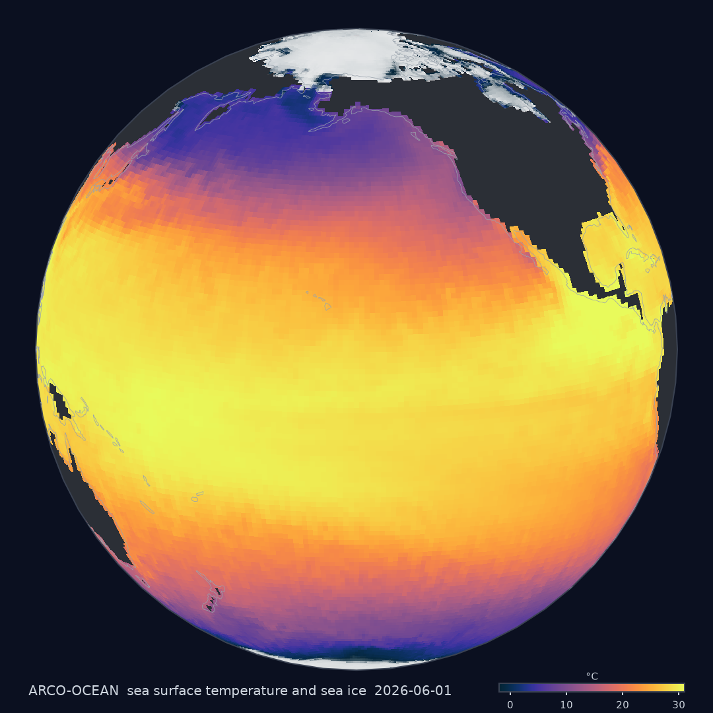

# An animation of ARCO-OCEAN (design proposal)

Roadmap item 5: an animation for the Earthmover marketplace listing and the documentation. This
is a proposal for the maintainer to review before any production rendering.

*Prototype frame, from the 1° output of the end-to-end check of 23 Nov (one historical day,
2026-06-01; the final animation would use 0.25°), drawn by [animation_frame.py](animation_frame.py).*

## What it shows

**A rotating globe with a year of the ocean's surface.** One frame per day; sea surface
temperature as colour; sea ice drawn over it in white, its opacity the concentration; land
dark. While the year runs, the globe turns once, so each ocean comes into view in its own
season:
- the Pacific's equatorial cold tongue;
- the Gulf Stream and the Kuroshio;
- the Arctic ice melting back in summer, and the Antarctic ice growing in austral winter.

**The year.** Proposed: 2023, El Niño's onset, when the eastern Pacific warms over the months.
It is within the historical dataset and well known; any year works.

## Why this design

- **One variable, one colour map.** Temperature is a magnitude, so it gets one sequential,
  perceptually uniform colour map: cmocean's `thermal`, dark purple to yellow. It reads under
  colour-vision deficiencies, unlike a rainbow, and stays legible on the dark background.
- **Sea ice in white over it.** No second colour scale: white is outside the colour map, and its
  opacity is the concentration, so the ice edge is soft where the ice is thin.
- **A globe, not a map.** A rotating globe avoids the distortion of flat maps at the poles,
  where the ice is, and shows ocean and ice together as one system, which is what the dataset
  merges.
- **A loop for the marketplace.** 12 s at 30 frames per second is 360 frames, one per day, and
  one turn of the globe. It loops without a jump in rotation, though one in season.

## Alternatives (pick one, or keep the proposal)

1. **Surface currents.** Speed from `uo`/`vo` (cmocean `speed`, on black), with particles
   advected along the currents. The most striking option, but rendering particles needs more
   than cartopy (a GPU renderer, or a few days of work), and the current speed at 0.25° is
   noisy.
2. **Anomalies.** Temperature minus the climatology (the statistics' `climatology` group), on a
   diverging map (blue, grey at zero, red). It shows El Niño best, but it needs the statistics
   and a legend that explains the anomaly.
3. **Depth.** A slice through the levels (temperature along the equator, 0-500 m) next to the
   globe: it shows that the dataset is 3D, but two panels are less suited to a thumbnail.

## How it would be made

- **Data.** Level 0 of `thetao` and `siconc` for 365 days at 0.25°, read anonymously from the
  published `historical/res=0p25` repository. A day's level is one stored chunk of 4 MB, so
  about 1.5 GB in all.
- **Frames.** matplotlib with cartopy's orthographic projection, which the prototype uses. The
  central longitude moves by 1° per frame, at a fixed latitude of about 12° (the equator's
  ocean in view, the Arctic at the rim). Frames are 1080 x 1080 pixels.
- **Video.** ffmpeg: H.264 MP4 for the marketplace, WebM for the documentation site, and a short
  GIF or WebP preview. Both repositories credit the sources (the `attribution` attribute) under
  the video.
- **Script.** `scripts/animation.py` in this repository: reproducible from the published data,
  with the year and the variable as options. The data are read once and the frames rendered in
  parallel processes.
- **Effort.** About a day for the script and a first video, once the 0.25° historical repository
  is published. The frames take minutes on the project VM.

## Open points

1. **Variable and year:** sea surface temperature with sea ice in 2023 (proposed), or currents
   or anomalies (alternatives above)?
2. **Text:** a title only (proposed), or also a date counter and a colour bar, as in the
   prototype? Earthmover's thumbnails may crop the frame.
3. **Branding:** Earthmover's marketplace may have size and length requirements, to check when
   listing (roadmap item 10).
